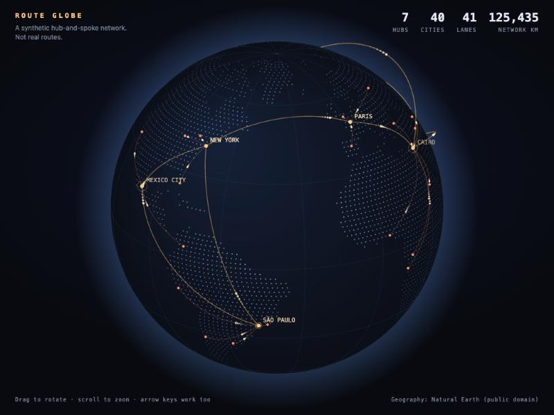

# route-globe

An interactive 3D globe of a delivery network, drawn on a plain `<canvas>`. **No libraries, no map tokens, no network requests.** About 300 lines of JavaScript: a canvas renderer and a small, tested geometry module.



The network is **synthetic**: real city locations as nodes, invented routes between them. Nothing here comes from a real fleet.

## Run it

```bash
python3 -m http.server 8000     # any static server works
# open http://localhost:8000
npm test                        # 19 tests
```

Drag (mouse or touch) to rotate with inertia, scroll to zoom, hover a city for its details. There is no pinch-zoom yet. Arrow keys rotate and `+`/`-` zoom, so it works without a mouse. With `prefers-reduced-motion` set, auto-rotation and pulses stop.

## How it works

| Piece | What it does |
|-------|--------------|
| `src/geo.js` | Pure geometry, no DOM: orthographic projection, horizon visibility, great-circle arcs, point-in-polygon, a seeded PRNG, and the network builder |
| `src/globe.js` | Canvas renderer: dotted land, graticule, arcs with travelling pulses, hub rings, hover picking, drag/zoom/keyboard input |
| `scripts/build-data.js` | Turns Natural Earth polygons into a dot-matrix land mask (3,788 dots, 33 KB) and picks the 40 largest cities |
| `index.html` | Wires it together; the stats in the header are computed from the generated network |

A few decisions worth knowing:

- **Dots, not filled land.** Filling polygons on an orthographic globe means clipping each one at the horizon. A dot grid, thinned toward the poles for even density, has no such problem and is tiny.
- **Arcs are lifted.** Each great circle rises above the surface in proportion to its length, so routes read as flights, not lines on the ground. A point on an arc that rises past the horizon stays visible even while the matching ground point is hidden.
- **Hub-and-spoke.** Hubs are the biggest cities that are at least 28° apart; every other city spokes to its *nearest* hub and each hub trunks to its two nearest hubs. A seeded PRNG makes the network reproducible.
- **Time-based motion.** Rotation and inertia scale by elapsed time, so a 120 Hz display doesn't spin twice as fast as a 60 Hz one.

## Tests

19 tests cover the projection (centre, edge, pole, radius), horizon visibility, great-circle endpoints and lift, point-in-polygon including holes and vertex-height edge cases, network determinism, connectivity, nearest-hub assignment, and sanity checks on the generated land and city data.

I checked the suite by injecting bugs into a copy (dropping the horizon rule, flipping the pitch sign, attaching spokes to the farthest hub, an off-by-one in the ray cast, and constant arc lift). The ray-cast bug initially survived, which exposed a missing vertex-height test; it is now caught, and all five injected bugs fail at least one test.

Verified in a browser: rendering, hover tooltip, drag, and a phone-width layout, with no console errors. Not verified: opening `index.html` straight from disk (`file://`), and behaviour on a 120 Hz display.

## Data and license

Code: MIT. Geography: [Natural Earth](https://www.naturalearthdata.com) (public domain), used to generate `data/land.js` and `data/cities.js`. Regenerate with `node scripts/build-data.js <countries.geojson> <populated_places.geojson>`.
